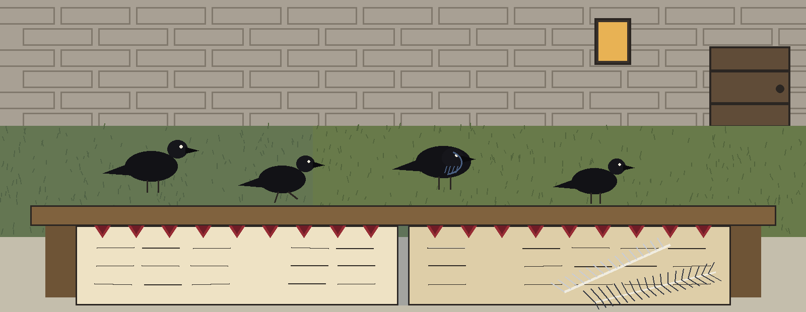

# dm-data-location-obfuscator

Chronicle entry, in the season of the wing clippings: the name above is set in Furgatorio in medieval madder, as a chronicle entry with a seasonal marker, with a small seal picture at the left of the title block and the wing clip record drawn small beside this first heading only.

# dm-data-location-obfuscator
Adds random noise to geographic coordinates (latitude/longitude) within a dataset, preserving general location but obscuring exact addresses. Uses a specified radius for the noise. - Focused on Tools designed to generate or mask sensitive data with realistic-looking but meaningless values

Every printed pair is a valid coordinate. Latitude is clamped into the -90 to 90 range and longitude is wrapped into the -180 to 180 range, so points near the poles or past the antimeridian stay in range. At a latitude whose cosine is near zero (the poles themselves), the longitude offset is left at zero instead of being divided by that near zero cosine.

> Ledger entry: latitude is clamped into its range.

> Ledger entry: longitude is wrapped into its range.

> Ledger entry: at the poles the longitude offset stays at zero.

## Install
`git clone https://github.com/ShadowGuard-AI/dm-data-location-obfuscator`

> Ledger entry: the README clone line names an older organisation.

## Usage
`python3 main.py latitude longitude radius [options]`

## Parameters
- `-h`: Show help message and exit
- `-v`: No description provided
- `-n`: Number of obfuscated points to generate.

## License
This project is released under the MIT License. See the [LICENSE](LICENSE) file for details.

## The ledger shut at lamplight

The main button of this re-skin reads Shift the Points. Its count field label reads Points to Generate. Its validity heading reads Every Pair Stays in Bounds. Its fetching correction heading reads The Printed Address Names an Older House. It ends indoors at lamplight: ledger shut, quill washed, ravens settled on their perches outside the window, and the record kept and handed on.
