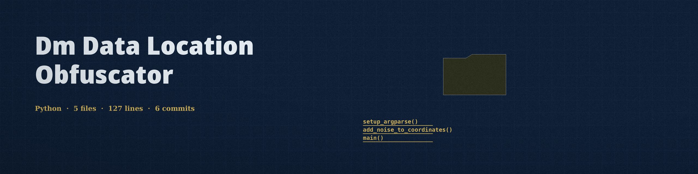

# dm-data-location-obfuscator
Adds random noise to geographic coordinates (latitude/longitude) within a dataset, preserving general location but obscuring exact addresses. Uses a specified radius for the noise. - Focused on Tools designed to generate or mask sensitive data with realistic-looking but meaningless values

Every printed pair is a valid coordinate. Latitude is clamped into the -90 to 90 range and longitude is wrapped into the -180 to 180 range, so points near the poles or past the antimeridian stay in range. At a latitude whose cosine is near zero (the poles themselves), the longitude offset is left at zero instead of being divided by that near zero cosine.

## Install
`git clone https://github.com/ShadowStrikeHQ/dm-data-location-obfuscator`

## Usage
`./dm-data-location-obfuscator [params]`

## Parameters
- `-h`: Show help message and exit
- `-v`: No description provided
- `-n`: Number of obfuscated points to generate.

## License
Copyright (c) ShadowStrikeHQ
